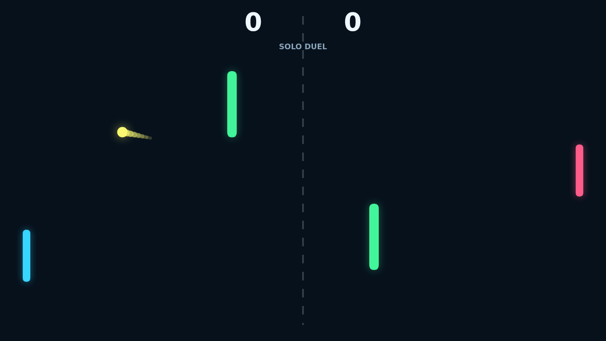

# Carom

Carom is a clean, fast paddle duel about reading the angle before it exists. A
serve snaps out from center court, the paddles close in, and every return asks
whether you want the safe straight shot or the risky curve that bends around the
middle posts.

Spin is the trick. Move through contact and the ball keeps turning after it
leaves your paddle, turning a simple rally into a drifting bank shot. The field's
two obstacles make that curve matter, because a shot can carom through the lane
or clip a post and change the whole exchange.

Solo mode gives you an AI opponent that tracks incoming attacks and recovers to
center. Versus mode turns the same field into a local duel, with one player on
`W` and `S` and the other on the arrow keys. First to 11 wins by two, so late
points become small, sharp tests of touch.
